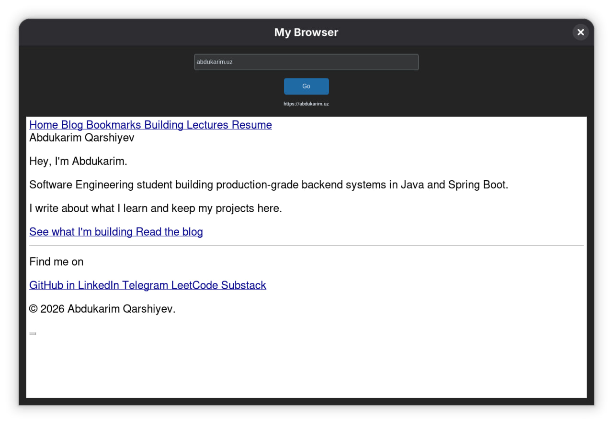
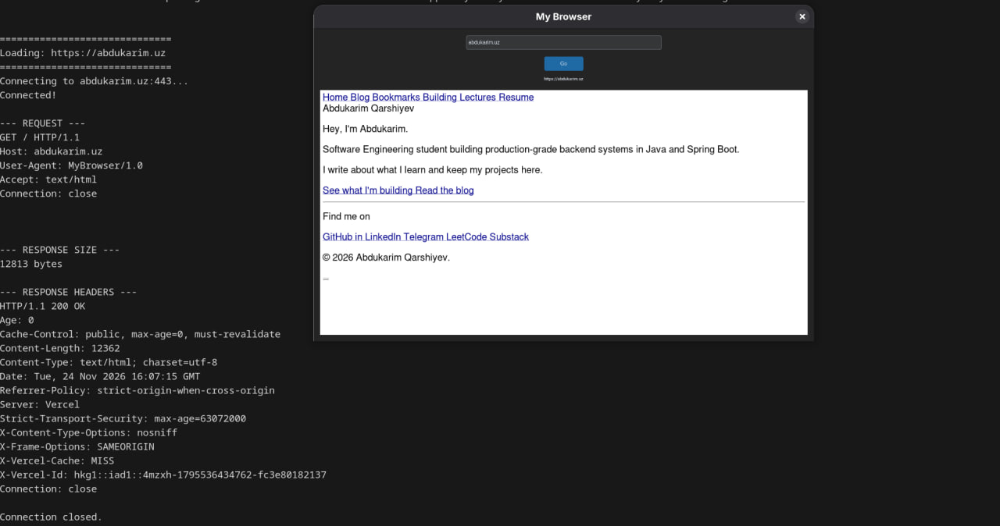

# Simple Browser


A small browser project built for learning how TCP, HTTP, HTTPS, and HTML rendering work.

### Features
- TCP connection 
- HTTP GET requests
- HTTPS
- HTTP response parsing
- HTML rendering
- CustomTkinter GUI
- TkinterWeb
- Python CLI client
- Go CLI client
### Project Structure

```txt
├── browser.py          # a simple GUI browser built with CustomTkinter
├── cli                  # CLI browsers written in Go and Python
│   ├── browser.go
│   └── browser.py
├── images/
├── README.md            # docs (you are reading it right now :)
└── requirements.txt     # required libraries with versions
```

### Installation
Install the libraries from `requirements.txt` with:
```shell
pip install -r requirements.txt
```
### Usage
use `python` or `go` to run the code. For example:
```
python3 file-name
```

for Go:
```
go run file-name.go
```
### How It Works
```
URL -> TCP -> HTTP -> HTTP Response -> HTML -> TkinterWeb
```
when the GUI browser runs, it looks like this:


and when the GUI browser sends a request, the terminal shows the HTTP request and response headers:


### HTTP Request
for example the browser sends:

```
GET / HTTP/1.1
Host: abdukarim.uz
User-Agent: MyBrowser/1.0
Accept: text/html
Connection: close
```

- `GET` is the HTTP method used to request a resource. 
- `/` is the path of the requested resource. 
- `HTTP/1.1` is the HTTP version.
- `Host` tells the server which website we want to access. 
- `User-Agent` identifies our browser. 
- `Accept` tells the server that we want HTML.
- `Connection: close` tells the server to close the connection after sending the response.

### HTTP Response
The server sends something like:
```
HTTP/1.1 200 OK
Content-Length: 12362
Content-Type: text/html; charset=utf-8
Server: Vercel
Connection: close
```

- `HTTP/1.1` is the HTTP version. 
- `200 OK` means the request was successful.
- `Content-Length` tells us the size of the response body.
- `Content-Type` tells us what kind of content the server sent.
- `Server` shows information about the server.
- `Connection: close` tells us that the connection will be closed after the response.
If you want to learn more about HTTP, check the [HTTP documentation](https://developer.mozilla.org/en-US/docs/Web/HTTP).

## Useful Docs
if you contributed to this repository, these docs might be useful:
- [CustomTkinter Documentation](https://customtkinter.tomschimansky.com/) 
- [TkinterWeb Documentation](https://tkinterweb.readthedocs.io/en/latest/)

Keep coding :)
